# 身份认证需求流

本文件覆盖 Task 9 的 Identity HTTP 与事件契约。所有 HTTP 响应沿用 `ApiResponse`；受保护的认证路由缺失或失效 JWT 为 `AUTH_UNAUTHORIZED`，管理员路由非 ADMIN 为 `AUTH_FORBIDDEN`。每节的“当前开发流”只列出 catalog 的 `currentSymbols`；实现测试是现有 `DocumentationCatalogCoverageTest#catalogOwnsTheExactApplicationRoutesSchedulersEventsAndTasks`，计划测试均为 **Phase 1**。

## IDN-001 登录

匿名用户提交 username、password、可选 deviceId 并取得 Bearer access/refresh token；账户必须可认证且 ACTIVE。同设备旧 refresh token 会撤销；登录成功写安全审计，认证失败由安全层拒绝。当前令牌签发、会话写入和审计在 `@AuthTransactional` 内原子完成；错误为认证失败或 `BUSINESS_ERROR`。实现测试：`DocumentationCatalogCoverageTest#catalogOwnsTheExactApplicationRoutesSchedulersEventsAndTasks`；计划测试（Phase 1）：`IdentityUseCaseWebTest#documentsIdentityUseCase`。

### Requirement flow {#idn-001}
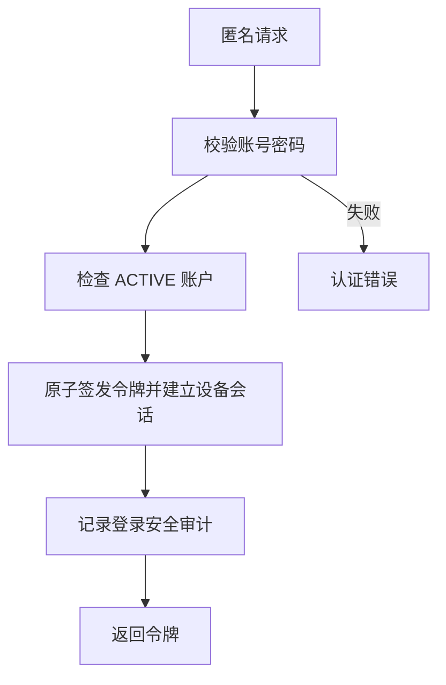
### Current development flow {#idn-001-dev}
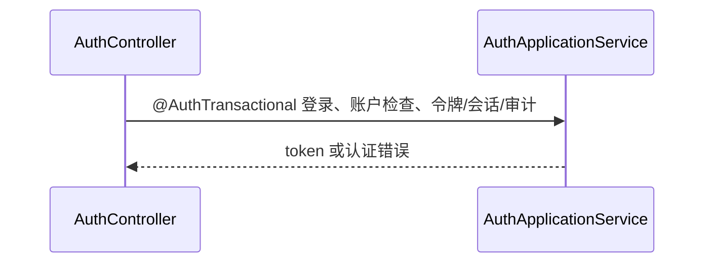
### Target architecture flow
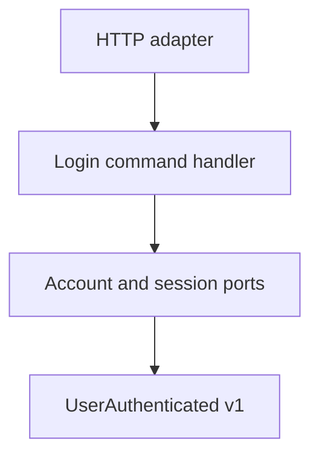
### Gaps
- targetPhase: 1；现有服务直接编排认证、令牌和审计，尚无命令处理器、端口或公开事件发布边界。

## IDN-002 当前用户

已认证用户用 JWT 查询自身 userId、用户名、角色、账户状态和 token 过期时间；JWT subject 找不到账户为当前实现错误。当前为 READ_COMMITTED、只读、30 秒事务，不创建会话或审计记录。实现测试：`DocumentationCatalogCoverageTest#catalogOwnsTheExactApplicationRoutesSchedulersEventsAndTasks`；计划测试（Phase 1）：`IdentityUseCaseWebTest#documentsIdentityUseCase`。

### Requirement flow {#idn-002}
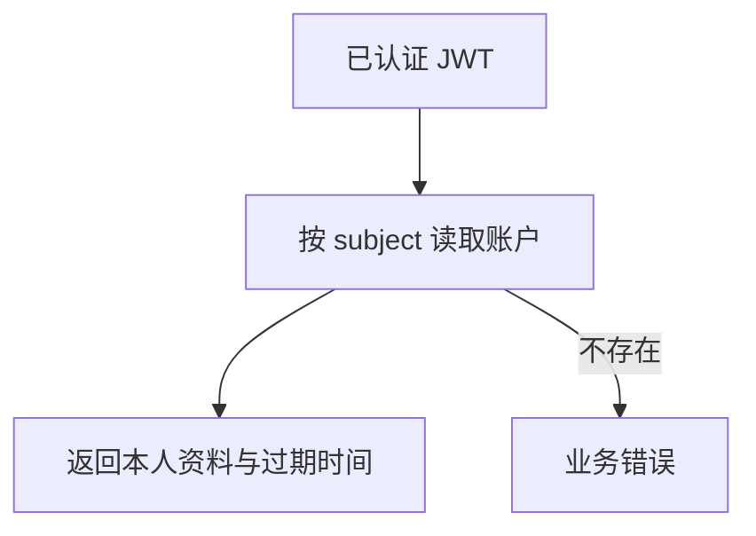
### Current development flow {#idn-002-dev}
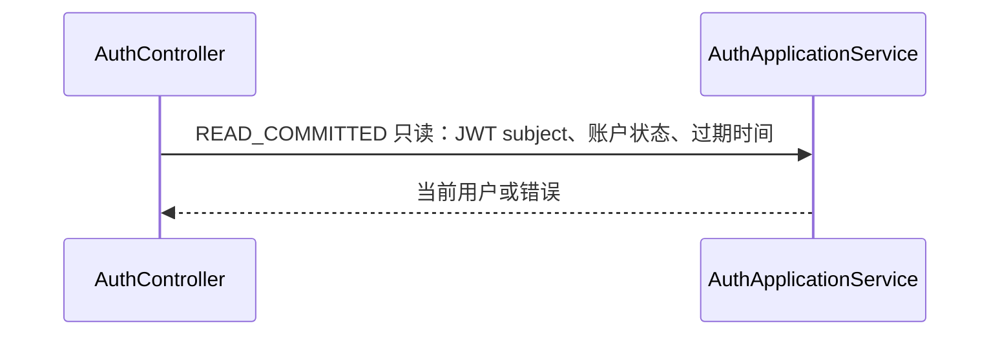
### Target architecture flow
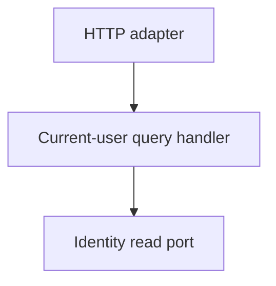
### Gaps
- targetPhase: 1；当前控制器/服务直接查询，尚无独立查询处理器与读端口。

## IDN-003 我的活动会话

已认证用户从 JWT subject 查询未撤销 refresh 会话，返回设备、创建和过期信息；只能读取本人会话。当前为 READ_COMMITTED 只读事务，无令牌变更或审计；认证失败由安全过滤器返回。实现测试：`DocumentationCatalogCoverageTest#catalogOwnsTheExactApplicationRoutesSchedulersEventsAndTasks`；计划测试（Phase 1）：`IdentityUseCaseWebTest#documentsIdentityUseCase`。

### Requirement flow {#idn-003}
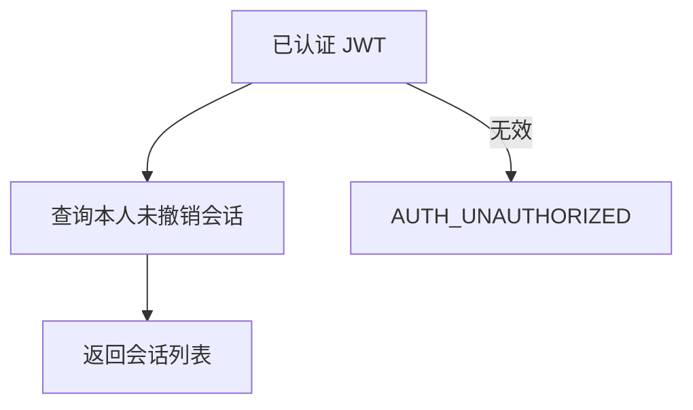
### Current development flow {#idn-003-dev}
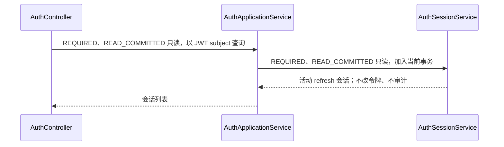
### Target architecture flow
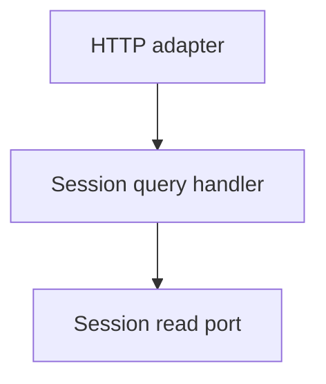
### Gaps
- targetPhase: 1；会话读取仍由现有服务委托，尚未隔离查询端口。

## IDN-004 撤销本设备会话

已认证用户提交 deviceId，只撤销本人同设备的未撤销 refresh token，并记录设备撤销安全审计；JWT access token 不在此接口加入黑名单。输入空白被校验；认证失败为 `AUTH_UNAUTHORIZED`。当前撤销和审计在 `@AuthTransactional` 内。实现测试：`DocumentationCatalogCoverageTest#catalogOwnsTheExactApplicationRoutesSchedulersEventsAndTasks`；计划测试（Phase 1）：`IdentityUseCaseWebTest#documentsIdentityUseCase`。

### Requirement flow {#idn-004}
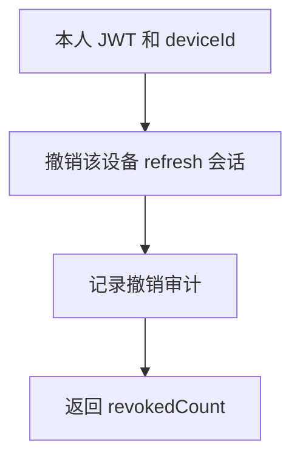
### Current development flow {#idn-004-dev}
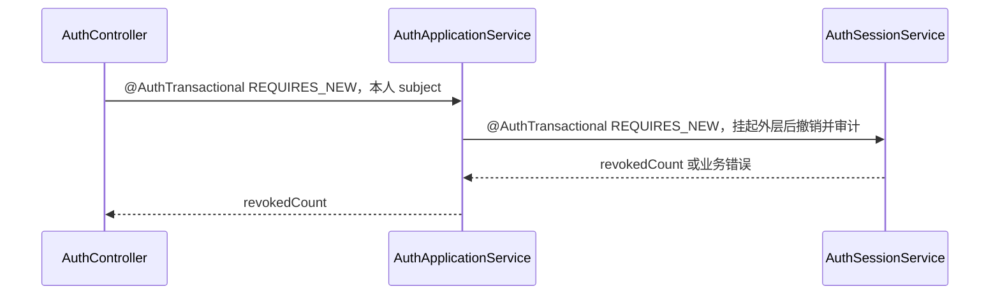
### Target architecture flow
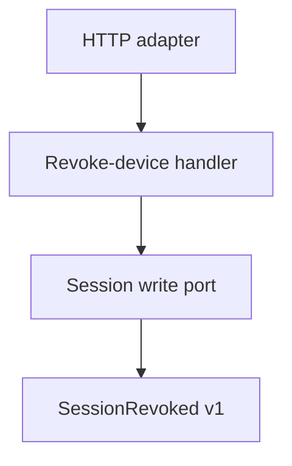
### Gaps
- targetPhase: 1；当前无会话撤销事件和端口化写模型。

## IDN-005 撤销我的全部会话

已认证用户撤销其全部未撤销 refresh token，记录全会话撤销审计并返回计数；当前 access token 不会因本操作立即进入黑名单。认证失败为 `AUTH_UNAUTHORIZED`，写入与审计在 `@AuthTransactional` 内。实现测试：`DocumentationCatalogCoverageTest#catalogOwnsTheExactApplicationRoutesSchedulersEventsAndTasks`；计划测试（Phase 1）：`IdentityUseCaseWebTest#documentsIdentityUseCase`。

### Requirement flow {#idn-005}
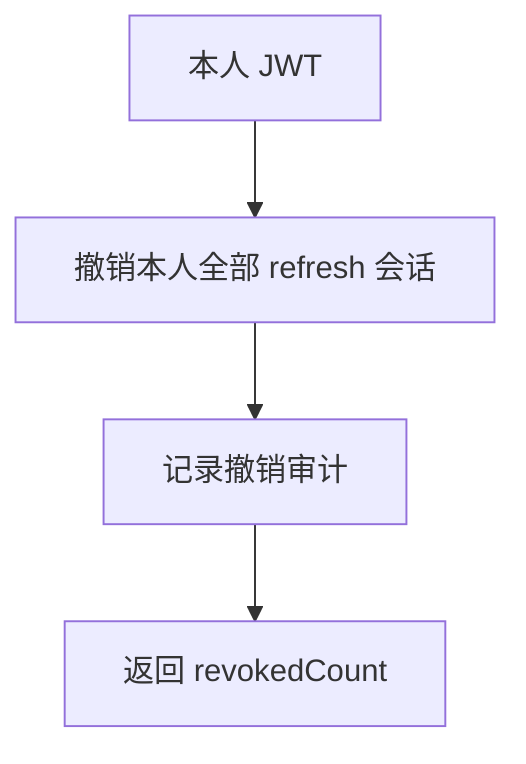
### Current development flow {#idn-005-dev}
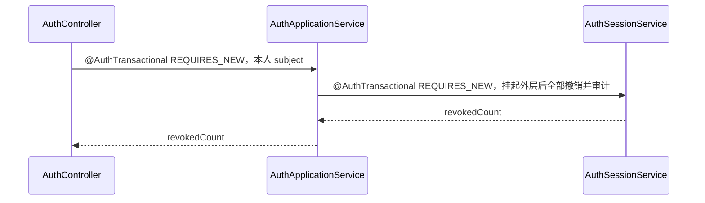
### Target architecture flow
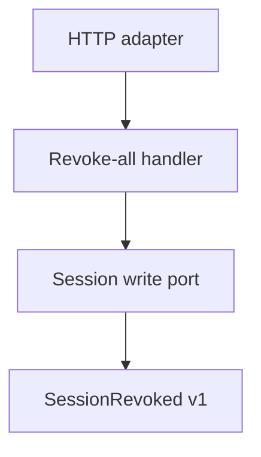
### Gaps
- targetPhase: 1；当前没有按领域事实发布会话撤销事件。

## IDN-006 登出

已认证用户登出；当前 JWT 有 jti 和过期时间时写黑名单，可选 refreshToken 被撤销，过期黑名单被清理并记录登出审计。请求主体缺失/无效由安全层拒绝；写操作在 `@AuthTransactional` 内。实现测试：`DocumentationCatalogCoverageTest#catalogOwnsTheExactApplicationRoutesSchedulersEventsAndTasks`；计划测试（Phase 1）：`IdentityUseCaseWebTest#documentsIdentityUseCase`。

### Requirement flow {#idn-006}
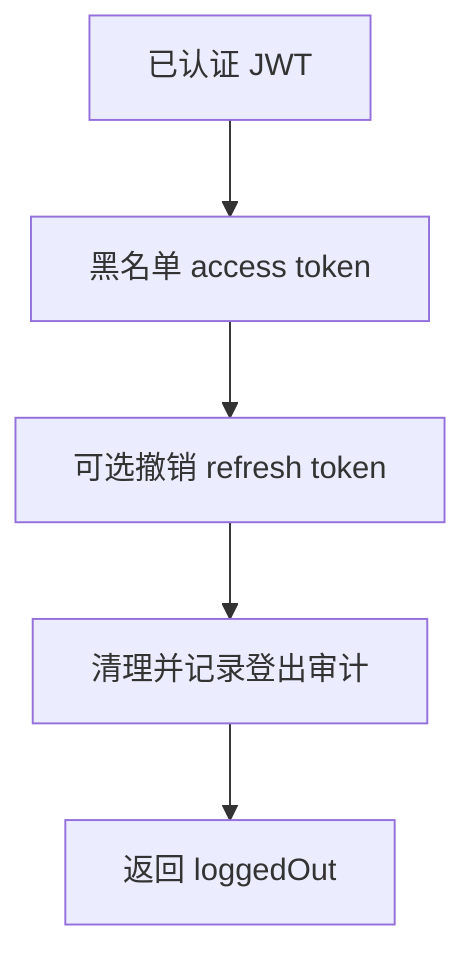
### Current development flow {#idn-006-dev}
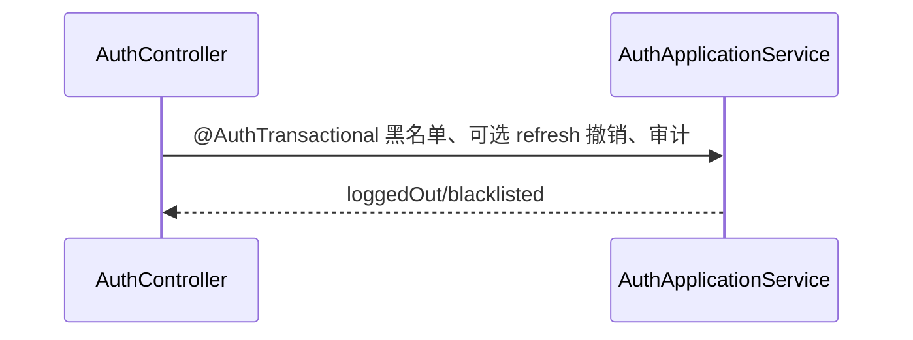
### Target architecture flow
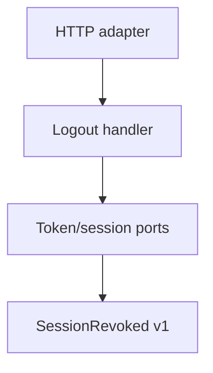
### Gaps
- targetPhase: 1；当前缺少独立登出命令及对外会话撤销事件。

## IDN-007 刷新令牌轮换

匿名刷新请求必须提供 refreshToken；服务清理过期 token，校验 token 存在、未撤销、未过期且设备匹配，先撤销旧 token 再创建新令牌/同设备会话并审计。发现重放时，代码会在抛出 `BizException` 前尝试撤销该用户全部活动 refresh token 并写重放审计；但 `@AuthTransactional(rollbackFor = Exception.class)` 随后回滚该事务，因此这些写入不会持久化。错误包括 `PARAM_INVALID`、`AUTH_REFRESH_TOKEN_INVALID`、`AUTH_REFRESH_TOKEN_EXPIRED`、`AUTH_REFRESH_TOKEN_DEVICE_MISMATCH`、`AUTH_REFRESH_REPLAY_BLOCKED`。实现测试：`DocumentationCatalogCoverageTest#catalogOwnsTheExactApplicationRoutesSchedulersEventsAndTasks`；计划测试（Phase 1）：`IdentityUseCaseWebTest#documentsIdentityUseCase`。

### Requirement flow {#idn-007}
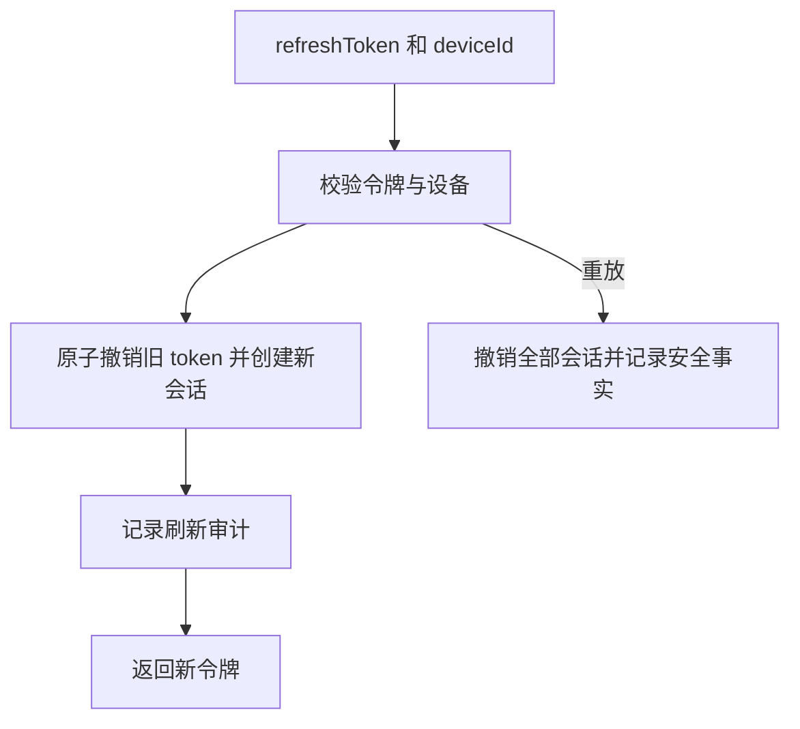
### Current development flow {#idn-007-dev}
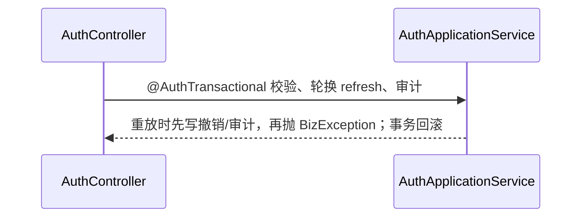
### Target architecture flow
```mermaid
flowchart TD
  C[HTTP adapter] --> H[Refresh command handler]
  H --> P[Refresh-session port]
  P --> E[RefreshSessionRotated v1]
```
### Gaps
- targetPhase: 1；当前重放分支的撤销和审计会随 `BizException` 回滚，需用独立持久化边界/outbox 保证阻断事实和安全事件可持久化；同时没有公开刷新/安全事件边界。

## IDN-008 注册

匿名用户提交 username、password、可选 deviceId 自助注册。用户名规则为 3-64 个非空白字符（去除首尾空白后），密码须为 8-64 个非空白字符；密码以委托编码器（默认 `{bcrypt}`）落库，绝不存明文。用户名唯一冲突为 `AUTH_USERNAME_EXISTS`，格式不合法为 `AUTH_USERNAME_INVALID` / `AUTH_PASSWORD_INVALID`。注册成功即按登录同路径签发 access/refresh token 并建立设备会话（撤销同设备旧 refresh token），写 `AUTH_REGISTER_SUCCESS` 审计；新账户固定 `role=USER`、`accountStatus=ACTIVE`、`level=NORMAL`、`points=0`。实现测试：`AuthRegisterWebTest#registersUserThenLoginWorksAndRejectsDuplicates`、`AuthRegisterWebTest#rejectsWeakPasswordAndBlankUsername`。

### Requirement flow {#idn-008}
```mermaid
flowchart TD
  A[匿名请求] --> V[校验用户名/密码规则]
  V -->|不合法| E1[AUTH_USERNAME_INVALID 或 AUTH_PASSWORD_INVALID]
  V --> U[检查用户名唯一]
  U -->|已存在| E2[AUTH_USERNAME_EXISTS]
  U -->|可用| C[创建 USER 账户并编码密码]
  C --> T[签发令牌并建立设备会话]
  T --> L[记录注册审计]
  L --> R[返回令牌]
```
### Current development flow {#idn-008-dev}
```mermaid
sequenceDiagram
  participant C as AuthController#register
  participant A as AuthApplicationService#register
  C->>A: @AuthTransactional 校验、建户、编码密码
  A->>A: normalizeUsername 规则化用户名
  A-->>C: 令牌或 AUTH_* 业务错误
```
### Target architecture flow
```mermaid
flowchart TD
  C[HTTP adapter] --> H[Register command handler]
  H --> P[Account write port]
  P --> E[UserRegistered v1]
```
### Gaps
- targetPhase: 1；注册已可用但与登录一样直接编排账户写入与令牌签发，尚无命令处理器、账户写端口或注册公开事件；未接入注册频控（属 M4 限流范围）。

## IDN-101 管理员查询用户会话

管理员以 username 查询目标用户未撤销 refresh 会话；路由由 ADMIN 角色保护。当前查询调用 `AUTH_ADMIN_SESSION_QUERY` 审计写入逻辑，但该调用加入 READ_COMMITTED 只读事务，本文不将其表述为独立持久化边界；不存在账户不会预先校验而是返回空会话集合。非管理员为 `AUTH_FORBIDDEN`。实现测试：`DocumentationCatalogCoverageTest#catalogOwnsTheExactApplicationRoutesSchedulersEventsAndTasks`；计划测试（Phase 1）：`IdentityUseCaseWebTest#documentsIdentityUseCase`。

### Requirement flow {#idn-101}
```mermaid
flowchart TD
  A[ADMIN 和 username] --> Q[读取目标活动会话]
  Q --> L[记录管理员查询审计]
  L --> R[返回会话列表]
```
### Current development flow {#idn-101-dev}
```mermaid
sequenceDiagram
  participant C as AdminAuthController#listUserSessions
  participant A as AuthApplicationService#adminListUserSessions
  participant S as AuthSessionService#adminListUserSessions
  C->>A: ADMIN 路由，REQUIRED、READ_COMMITTED 只读
  A->>S: REQUIRED、READ_COMMITTED 只读，查询并尝试审计
  S-->>A: 目标用户会话列表
  A-->>C: 会话列表
```
### Target architecture flow
```mermaid
flowchart TD
  C[Admin HTTP adapter] --> H[Admin session-query handler]
  H --> P[Session read/audit ports]
```
### Gaps
- targetPhase: 1；当前管理员授权仅在路由层，查询与审计未拆分为用例边界。

## IDN-102 管理员撤销用户设备会话

管理员提交 username 和 deviceId，撤销目标用户该设备活动 refresh token，记录管理员撤销审计并返回计数；路由要求 ADMIN。请求字段为空触发校验，非管理员为 `AUTH_FORBIDDEN`；写入及审计位于 `@AuthTransactional`。实现测试：`DocumentationCatalogCoverageTest#catalogOwnsTheExactApplicationRoutesSchedulersEventsAndTasks`；计划测试（Phase 1）：`IdentityUseCaseWebTest#documentsIdentityUseCase`。

### Requirement flow {#idn-102}
```mermaid
flowchart TD
  A[ADMIN、username、deviceId] --> R[撤销目标设备会话]
  R --> L[记录管理员撤销审计]
  L --> O[返回 revokedCount]
```
### Current development flow {#idn-102-dev}
```mermaid
sequenceDiagram
  participant C as AdminAuthController#revokeUserDevice
  participant A as AuthApplicationService#adminRevokeUserDeviceSession
  participant S as AuthSessionService#adminRevokeUserDeviceSession
  C->>A: ADMIN 路由，@AuthTransactional REQUIRES_NEW
  A->>S: @AuthTransactional REQUIRES_NEW，挂起外层后撤销并审计
  S-->>A: revokedCount
  A-->>C: revokedCount
```
### Target architecture flow
```mermaid
flowchart TD
  C[Admin HTTP adapter] --> H[Admin revoke-device handler]
  H --> P[Session write/audit ports]
  P --> E[SessionRevoked v1]
```
### Gaps
- targetPhase: 1；现有实现不发布管理员撤销产生的领域事件。

## IDN-103 管理员撤销用户全部会话

管理员提交 username，撤销目标用户全部活动 refresh token，记录管理员全会话撤销审计并返回数量；路由要求 ADMIN。字段校验失败为业务错误，非管理员为 `AUTH_FORBIDDEN`；写操作及审计在 `@AuthTransactional` 内。实现测试：`DocumentationCatalogCoverageTest#catalogOwnsTheExactApplicationRoutesSchedulersEventsAndTasks`；计划测试（Phase 1）：`IdentityUseCaseWebTest#documentsIdentityUseCase`。

### Requirement flow {#idn-103}
```mermaid
flowchart TD
  A[ADMIN 和 username] --> R[撤销目标全部 refresh 会话]
  R --> L[记录管理员撤销审计]
  L --> O[返回 revokedCount]
```
### Current development flow {#idn-103-dev}
```mermaid
sequenceDiagram
  participant C as AdminAuthController#revokeUserAll
  participant A as AuthApplicationService#adminRevokeUserAllSessions
  participant S as AuthSessionService#adminRevokeUserAllSessions
  C->>A: ADMIN 路由，@AuthTransactional REQUIRES_NEW
  A->>S: @AuthTransactional REQUIRES_NEW，挂起外层后全部撤销并审计
  S-->>A: revokedCount
  A-->>C: revokedCount
```
### Target architecture flow
```mermaid
flowchart TD
  C[Admin HTTP adapter] --> H[Admin revoke-all handler]
  H --> P[Session write/audit ports]
  P --> E[SessionRevoked v1]
```
### Gaps
- targetPhase: 1；当前管理员动作未形成端口化的跨用户会话用例。

## IDN-020 我的地址列表

已认证用户查看本人收货地址，默认地址在前、其余按 id 倒序；只能读到本人地址。实现测试：`AddressWebTest#createsListsAndSetsSingleDefaultAddress`、`AddressWebTest#isolatesAddressesBetweenUsers`。

### Requirement flow {#idn-020}
```mermaid
flowchart TD
  J[已认证 JWT] --> Q[查询本人地址] --> R[默认在前返回]
```
### Current development flow {#idn-020-dev}
```mermaid
sequenceDiagram
  participant C as AddressController#listAddresses
  participant S as UserAddressService#listByUser
  C->>S: JWT subject
  S-->>C: 地址列表
```
### Target architecture flow
```mermaid
flowchart TD
  C[HTTP adapter] --> H[Address query handler] --> P[Address read port]
```
### Gaps
- targetPhase: 1；地址簿读取与账户域同库，尚未拆独立读端口。

## IDN-021 新增收货地址

已认证用户创建收货地址；收货人/电话/省市区/详细地址必填，电话须 5-20 位数字（可带 + 前缀），`isDefault=true` 时同时设为默认（默认唯一）。实现测试：`AddressWebTest#createsListsAndSetsSingleDefaultAddress`、`AddressWebTest#rejectsBlankReceiverFields`。

### Requirement flow {#idn-021}
```mermaid
flowchart TD
  J[本人 + 地址字段] --> V[字段与电话格式校验]
  V -->|不合法| E[PARAM_INVALID]
  V --> W[写入地址] --> D{设为默认?}
  D -->|是| S[清旧默认并设新默认]
```
### Current development flow {#idn-021-dev}
```mermaid
sequenceDiagram
  participant C as AddressController#createAddress
  participant S as UserAddressService#create
  C->>S: JWT subject + 地址字段
  S-->>C: addressId
```
### Target architecture flow
```mermaid
flowchart TD
  C[HTTP adapter] --> H[Create-address command] --> P[Address write port]
```
### Gaps
- targetPhase: 1；地址数量上限未限制（生产应加每用户上限与风控）。

## IDN-022 修改收货地址

已认证用户修改本人地址字段（不改变默认态）；他人地址按不存在处理为 `ADDRESS_NOT_FOUND`。实现测试：`AddressWebTest#createsListsAndSetsSingleDefaultAddress`、`AddressWebTest#isolatesAddressesBetweenUsers`。

### Requirement flow {#idn-022}
```mermaid
flowchart TD
  J[本人 + addressId + 字段] --> V[归属与格式校验]
  V -->|非本人/不存在| E[ADDRESS_NOT_FOUND]
  V --> W[更新地址]
```
### Current development flow {#idn-022-dev}
```mermaid
sequenceDiagram
  participant C as AddressController#updateAddress
  participant S as UserAddressService#update
  C->>S: JWT subject、addressId、字段
  S-->>C: 更新后地址
```
### Target architecture flow
```mermaid
flowchart TD
  C[HTTP adapter] --> H[Update-address command] --> P[Address write port]
```
### Gaps
- targetPhase: 1；无地址变更审计与修改历史。

## IDN-023 删除收货地址

已认证用户删除本人地址（`ADDRESS_NOT_FOUND` 校验归属）；已下订单持有的是地址快照，不受删除影响。实现测试：`AddressWebTest#createsListsAndSetsSingleDefaultAddress`。

### Requirement flow {#idn-023}
```mermaid
flowchart TD
  J[本人 + addressId] --> V[归属校验] --> W[删除地址] --> R[deleted=true]
```
### Current development flow {#idn-023-dev}
```mermaid
sequenceDiagram
  participant C as AddressController#deleteAddress
  participant S as UserAddressService#delete
  C->>S: JWT subject、addressId
  S-->>C: deleted=true
```
### Target architecture flow
```mermaid
flowchart TD
  C[HTTP adapter] --> H[Delete-address command] --> P[Address write port]
```
### Gaps
- targetPhase: 1；删除默认地址后不自动迁移默认态。

## IDN-024 设为默认地址

已认证用户把本人某地址设为默认：清掉旧默认保证一人一默认。实现测试：`AddressWebTest#createsListsAndSetsSingleDefaultAddress`。

### Requirement flow {#idn-024}
```mermaid
flowchart TD
  J[本人 + addressId] --> V[归属校验] --> C[清除旧默认] --> S[设新默认]
```
### Current development flow {#idn-024-dev}
```mermaid
sequenceDiagram
  participant C as AddressController#setDefaultAddress
  participant S as UserAddressService#setDefault
  C->>S: JWT subject、addressId
  S-->>C: isDefault=true
```
### Target architecture flow
```mermaid
flowchart TD
  C[HTTP adapter] --> H[Set-default command] --> P[Address write port]
```
### Gaps
- targetPhase: 1；默认态切换未发布领域事件。

## IDN-E001 UserAuthenticated v1

系统在认证成功后应发布版本 1 的 `UserAuthenticated`，供内部订阅方消费；权限为 internal，投递失败应可重试。当前登录会写令牌/会话和登录审计，但没有该事件发布或提交后投递事务。实现测试：`DocumentationCatalogCoverageTest#catalogOwnsTheExactApplicationRoutesSchedulersEventsAndTasks`；计划测试（Phase 1）：`IdentityEventContractTest#documentsIdentityEvent`。

### Requirement flow {#idn-e001}
```mermaid
flowchart TD
  A[认证成功] --> E[发布 UserAuthenticated v1]
  E --> D[可重试内部投递]
```
### Current development flow {#idn-e001-dev}
```mermaid
flowchart TD
  C[AuthApplicationService#login] --> N[当前登录审计；没有 UserAuthenticated 发布]
```
### Target architecture flow
```mermaid
flowchart TD
  F[认证领域事实] --> O[Outbox]
  O --> E[UserAuthenticated v1]
```
### Gaps
- targetPhase: 1；已实现：UserAuthenticated v1（suno-identity api.event）在密码登录/注册即登录/短信登录成功后经 JpaEventOutbox 发布（via 区分来源），由 OPS-S002 派发；测试 `OutboxEventsWebTest#lifecycleEventsReachOutbox`。

## IDN-E002 RefreshSessionRotated v1

系统在 refresh 原子轮换完成后应发布版本 1 的 `RefreshSessionRotated`；只能在提交成功后投递，失败可重试。当前没有该事件或发布事务。实现测试：`DocumentationCatalogCoverageTest#catalogOwnsTheExactApplicationRoutesSchedulersEventsAndTasks`；计划测试（Phase 1）：`IdentityEventContractTest#documentsIdentityEvent`。

### Requirement flow {#idn-e002}
```mermaid
flowchart TD
  R[refresh 会话轮换完成] --> E[发布 RefreshSessionRotated v1]
  E --> D[可重试内部投递]
```
### Current development flow {#idn-e002-dev}
```mermaid
flowchart TD
  C[AuthApplicationService#refresh] --> N[当前轮换/审计；没有 RefreshSessionRotated 发布]
```
### Target architecture flow
```mermaid
flowchart TD
  F[轮换领域事实] --> O[Outbox] --> E[RefreshSessionRotated v1]
```
### Gaps
- targetPhase: 1；IDN-E002 为 absent，缺少提交后发布与可重试投递。

## IDN-E003 SessionRevoked v1

系统在本人或管理员撤销 refresh 会话后应发布版本 1 的 `SessionRevoked`，包含可追踪的撤销事实；内部投递失败可重试。当前没有该公共事件或事务性发布。实现测试：`DocumentationCatalogCoverageTest#catalogOwnsTheExactApplicationRoutesSchedulersEventsAndTasks`；计划测试（Phase 1）：`IdentityEventContractTest#documentsIdentityEvent`。

### Requirement flow {#idn-e003}
```mermaid
flowchart TD
  R[会话撤销完成] --> E[发布 SessionRevoked v1]
  E --> D[可重试内部投递]
```
### Current development flow {#idn-e003-dev}
```mermaid
flowchart TD
  C[AuthApplicationService#revokeAllSessions] --> N[当前撤销/审计；没有 SessionRevoked 发布]
```
### Target architecture flow
```mermaid
flowchart TD
  F[撤销领域事实] --> O[Outbox] --> E[SessionRevoked v1]
```
### Gaps
- targetPhase: 1；IDN-E003 为 absent，尚未把撤销审计转化为公开领域事件。

## IDN-E004 SecurityIncidentRaised v1

系统在安全事件（例如 refresh 重放阻断）成立后应发布版本 1 的 `SecurityIncidentRaised`，供内部风险处理订阅；投递失败可重试。当前安全审计会记录部分事件，但没有对应公共事件、投递边界或事务。实现测试：`DocumentationCatalogCoverageTest#catalogOwnsTheExactApplicationRoutesSchedulersEventsAndTasks`；计划测试（Phase 1）：`IdentityEventContractTest#documentsIdentityEvent`。

### Requirement flow {#idn-e004}
```mermaid
flowchart TD
  I[安全事件成立] --> E[发布 SecurityIncidentRaised v1]
  E --> D[可重试内部投递]
```
### Current development flow {#idn-e004-dev}
```mermaid
flowchart TD
  C[AuthApplicationService#refresh] --> N[当前重放阻断审计；没有 SecurityIncidentRaised 发布]
```
### Target architecture flow
```mermaid
flowchart TD
  F[安全领域事实] --> O[Outbox] --> E[SecurityIncidentRaised v1]
```
### Gaps
- targetPhase: 1；IDN-E004 为 absent，审计记录尚未成为版本化公共安全事件。

## IDN-110 管理员用户分页

管理员按用户名关键词/status 分页查看用户（角色/状态/等级/积分）。实现测试：`AdminConsoleWebTest#bansUserAndBlocksLogin`。

### Requirement flow {#idn-110}
```mermaid
flowchart TD
  A[ADMIN + keyword/status] --> Q[Specification 分页] --> R[零基分页]
```
### Current development flow {#idn-110-dev}
```mermaid
sequenceDiagram
  participant C as AdminUserController#pageUsers
  participant S as AdminUserService#pageUsers
  C->>S: 过滤与分页
  S-->>C: content/totalElements/...
```
### Target architecture flow
```mermaid
flowchart TD
  C[Admin HTTP adapter] --> H[Admin user page handler] --> P[Domain port]
```
### Gaps
- targetPhase: 3；用户查询与账户域同库，尚无独立管理读模型。

## IDN-111 管理员封禁/解封用户

管理员把用户置为 BANNED（同时撤销其全部会话，登录立即失败）或恢复 ACTIVE；仅允许 ACTIVE/BANNED，ADMIN 账户不可封禁（`AUTH_FORBIDDEN`），写审计。实现测试：`AdminConsoleWebTest#bansUserAndBlocksLogin`。

### Requirement flow {#idn-111}
```mermaid
flowchart TD
  A[ADMIN + userId + status] --> V{非 ADMIN 账户}
  V -->|是| E[AUTH_FORBIDDEN]
  V -->|否| U[更新状态]
  U -->|BANNED| R[撤销全部会话]
```
### Current development flow {#idn-111-dev}
```mermaid
sequenceDiagram
  participant C as AdminUserController#setUserStatus
  participant S as AdminUserService#setUserStatus
  participant A as AuthSessionService#adminRevokeUserAllSessions
  C->>S: userId、status
  S->>A: BANNED 时撤销会话
  S-->>C: accountStatus
```
### Target architecture flow
```mermaid
flowchart TD
  C[Admin HTTP adapter] --> H[Admin user status handler] --> P[Domain port]
```
### Gaps
- targetPhase: 3；封禁不发布公开事件，已签发 access token 靠会话撤销+黑名单兜底。

## IDN-009 发送短信验证码

匿名用户提交 11 位手机号获取 6 位验证码（5 分钟有效，默认 60 秒发送间隔限频；路由级另受 M4 限流保护）。发送通道由 Provider 隔离，当前为日志实现；`security.auth.sms.dev-echo=true`（仅开发/测试）在响应回显 devCode 供联调，生产必须关闭。实现测试：`GrowthFeaturesWebTest#smsCodeLoginConsumesCodeAndAutoRegisters`。

### Requirement flow {#idn-009}
```mermaid
flowchart TD
  A[手机号] --> V[格式校验] --> R[间隔限频] --> G[生成 6 位码] --> W[落库 5 分钟有效]
```
### Current development flow {#idn-009-dev}
```mermaid
sequenceDiagram
  participant C as AuthController#sendSmsCode
  participant S as SmsCodeService#send
  C->>S: phone
  S-->>C: expireMinutes（dev 回显 devCode）
```
### Target architecture flow
```mermaid
flowchart TD
  C[HTTP adapter] --> H[Sms send handler] --> P[Domain port]
```
### Gaps
- targetPhase: 1；短信服务商 Provider 未接入（日志兜底），无图形验证码防护。

## IDN-010 短信验证码登录

匿名用户提交手机号+验证码：校验后一次性消费验证码（重放拒绝），已有账户直接签发令牌、无账户自动注册（用户名=手机号、随机不可登录密码）。用户创建与令牌签发在同一个 `@AuthTransactional` 内（REQUIRES_NEW 边界内可见）。实现测试：`GrowthFeaturesWebTest#smsCodeLoginConsumesCodeAndAutoRegisters`。

### Requirement flow {#idn-010}
```mermaid
flowchart TD
  A[手机号+码] --> V[未用且未过期] -->|否| E[AUTH_BAD_CREDENTIALS]
  V -->|是| U[一次性消费]
  U --> F[找/建账户] --> T[签发令牌]
```
### Current development flow {#idn-010-dev}
```mermaid
sequenceDiagram
  participant C as AuthController#smsLogin
  participant S as SmsCodeService#loginBySms
  participant A as AuthApplicationService#loginOrRegisterByPhone
  C->>S: phone、code
  S->>A: 单事务找/建账户并签发
  S-->>C: 令牌
```
### Target architecture flow
```mermaid
flowchart TD
  C[HTTP adapter] --> H[Sms login handler] --> P[Domain port]
```
### Gaps
- targetPhase: 1；未接微信/Apple 等第三方登录；自动注册无手机号唯一性之外的资料收集。
