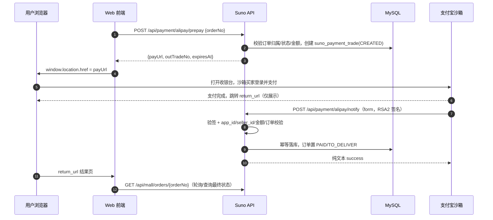

# 支付宝沙箱支付接入方案

> **For agentic workers:** 本文件是实施方案，不是已实现代码。执行时按 Task 顺序推进，每个 Task 完成后跑对应测试；涉及新增 HTTP 端点时必须同步 `docs/requirements/use-cases.yaml` 与流程文档，否则 `DocumentationCatalogCoverageTest` / `DocumentationFlowCoverageTest` 会失败。

**Goal:** 在现有二销订单链路中接入支付宝电脑网站支付（沙箱），用真实 RSA2 验签替换当前共享 HMAC 的模拟网关，打通「下单 → 拉起支付宝收银台 → 异步通知 → 订单 PAID」全流程，并保证重复通知、伪造通知、金额篡改、超时关单竞态都不会造成错账。

**Architecture:** 支付宝渠道能力收敛到 `suno-payment`（签名、预支付 URL、交易记录、通知验签），`suno-bootstrap` 只保留 HTTP 端点与订单编排（因为订单聚合仍在 bootstrap 的遗留服务中）。不引入官方 SDK，使用 JDK `SHA256withRSA` + Jackson + JDK `HttpClient` 自建薄适配器，避免 SDK 的旧版 fastjson/BC/dom4j/OkHttp 传递依赖冲击 Java 25、`dependencyConvergence` 和 `banDuplicateClasses` 门禁。

**Tech Stack:** Java 25、Spring Boot 3.5.16、Spring MVC、Spring Data JPA、Flyway、Jackson、JDK `java.security` / `java.net.http`、H2（dev）与 MySQL（prod）。

---

## 1. 现状：现在的「支付」是什么

当前仓库没有真实支付渠道。`/api/mall/orders/pay` 和 `/api/payment/callback` 共用一套**共享密钥 HMAC 模拟网关**，本质是开发期替身：

| 环节 | 现状 | 位置 |
| --- | --- | --- |
| 下单 | 生成 `B2C-XXXXXXXX`，金额取商品 `sale_price`，状态 `UNPAID/WAIT_PAY` | `ResaleMallController#createOrder` → `ResaleOrderService#createResaleOrder` |
| 发起支付 | 客户端用共享密钥对 `orderNo\|idempotencyKey\|timestamp\|nonce` 做 HMAC-SHA256，POST `/api/mall/orders/pay` | `ResaleMallController.java:114-125` |
| 验签/防重放 | 校验时间窗（默认 300s）+ nonce 唯一 + 常量时间比较 | `PaymentSignatureService#verifyOrThrow` |
| 回调 | 网关（或测试脚本）POST `/api/payment/callback`，字段同上 + `payStatus` | `PaymentCallbackController` |
| 幂等 | `suno_payment_idempotency` 按 `idempotency_key` 去重 | `ResaleOrderService#markResaleOrderPaidWithIdempotency` |
| 状态流转 | 只允许从 `UNPAID` 置 `PAID/TO_DELIVER`，写审计 | `ResaleOrderService#markResaleOrderPaid` |
| 重放/补偿 | 回调日志、重放任务、admin 诊断接口 | `AdminPaymentController`、`PaymentReplayService` |

**它解决了什么：** 验签、时间窗、nonce 防重放、幂等落库、状态机、审计、失败重放，这些「支付周边」已经成型，接入真实渠道时可以复用大部分思想。

**它缺什么：**

1. 没有渠道预支付单：不调用支付宝，不生成 `trade_no`，没有收银台跳转。
2. 没有非对称签名：HMAC 共享密钥意味着**持有密钥的一方可以给任意订单伪造支付成功**；`/api/mall/orders/pay` 也不校验订单买家，生产环境不可用。
3. 没有渠道交易记录：`suno_resale_order` 没有 `pay_channel`、`trade_no`、`paid_at`，无法对账/退款。
4. 回调响应格式是 JSON（`payment.callback.response-mode`），而支付宝要求纯文本 `success`，不能直接复用。
5. 自动关单存在竞态：`autoCloseExpiredUnpaidOrders` 只改 `fulfillStatus=AUTO_CLOSED`，`payStatus` 仍是 `UNPAID`，迟到的支付通知仍会被 `markResaleOrderPaid` 接受（`ResaleOrderService.java:427` 附近）。
6. 重放服务绕过验签，并把任意非 `UNPAID` 状态当成重放成功（`docs/requirements/payment.md` PAY-102 已记录）。

结论：**保留现有 HMAC 链路作为 dev/test 的 Mock Provider，新建一条独立的支付宝渠道链路；不要改造旧回调端点去兼容支付宝。**

---

## 2. 目标链路



关键原则：

- **同步 `return_url` 只用于跳转展示，绝不作为支付成功依据。** 唯一可信来源是验签通过的异步通知或主动查询。
- **通知必须幂等。** 支付宝会重试 8 次（约 25 小时），同一笔交易可能收到多条 `TRADE_SUCCESS`。
- **金额以分为单位比较。** 通知里的 `total_amount` 是字符串元，必须 `BigDecimal.compareTo`，不能字符串相等。
- **回调必须返回纯文本 `success`。** 返回 JSON、`SUCCESS`、带引号都会被当作失败并触发重试。

---

## 3. 模块与包落位

`suno-payment` 目前只有 `package-info.java` 和 `V4000__payment_baseline.sql`，是天然的归属模块；`suno-bootstrap` 是 composition root，保留控制器和订单编排。

```text
suno-payment/src/main/java/com/suno/mall/payment/
├── domain/
│   ├── AlipaySignature.java          # 规范化、RSA2 签名/验签（纯 JDK，无 Spring）
│   ├── AlipayPagePayRequest.java     # 预支付参数值对象
│   ├── AlipayTradeStatus.java        # WAIT_BUYER_PAY/TRADE_SUCCESS/TRADE_FINISHED/TRADE_CLOSED
│   └── PaymentTradeStatus.java       # CREATED/PAID/CLOSED/REFUNDED
├── application/
│   ├── AlipayPagePayService.java     # 组装公共参数 + biz_content，返回 payUrl
│   ├── PaymentTradeService.java      # 交易记录创建/查询/状态推进
│   └── AlipayNotifyVerifier.java     # 通知验签 + 业务字段校验
└── internal/
    ├── AlipayProperties.java         # @ConfigurationProperties("payment.alipay")
    ├── AlipayConfiguration.java      # 条件装配、密钥解析、HttpClient
    ├── AlipayOpenApiClient.java      # trade.query / trade.close / trade.refund
    ├── PaymentTradeEntity.java
    ├── PaymentNotifyLogEntity.java
    └── PaymentTradeRepository.java
```

`suno-bootstrap` 新增：

```text
suno-bootstrap/src/main/java/com/suno/mall/controller/
├── AlipayPaymentController.java      # prepay / return
└── AlipayNotifyController.java       # notify（form，plain text）
```

> 为什么不把控制器放进 `suno-payment`：预支付需要读取 `suno_resale_order` 并校验买家归属，而该聚合目前仍在 bootstrap 的遗留服务里。等订单垂直切片迁入 `suno-marketplace` 后，再把控制器下沉到 payment，避免现在为了「架构纯洁」引入跨模块端口和额外事务边界。

### POM 变更

`suno-payment/pom.xml` 增加（版本由父 BOM 管理，不写版本号）：

```xml
<dependency>
    <groupId>org.springframework.boot</groupId>
    <artifactId>spring-boot-starter-data-jpa</artifactId>
</dependency>
<dependency>
    <groupId>org.springframework.boot</groupId>
    <artifactId>spring-boot-starter-validation</artifactId>
</dependency>
<dependency>
    <groupId>com.fasterxml.jackson.core</groupId>
    <artifactId>jackson-databind</artifactId>
</dependency>
```

不增加 `spring-boot-starter-web`：payment 不暴露 HTTP，`AlipayOpenApiClient` 用 JDK `HttpClient`，避免模块间 Web 依赖扩散。

---

## 4. 接口设计

### 4.1 发起支付

```http
POST /api/payment/alipay/prepay
Authorization: Bearer <JWT>
Content-Type: application/json

{ "orderNo": "B2C-1A2B3C4D" }
```

成功响应：

```json
{
  "success": true,
  "message": "ok",
  "errorCode": null,
  "data": {
    "orderNo": "B2C-1A2B3C4D",
    "outTradeNo": "B2C-1A2B3C4D",
    "payUrl": "https://openapi-sandbox.dl.alipaydev.com/gateway.do?app_id=...&sign=...",
    "expiresAt": "2026-10-23T22:45:00+08:00"
  }
}
```

服务端校验顺序：

1. 当前登录用户 == `order.buyerUser.id`，否则 `FORBIDDEN`。
2. `payStatus == UNPAID` 且 `fulfillStatus == WAIT_PAY`，否则 `ORDER_STATUS_CONFLICT`。
3. 订单未超过支付窗口（与 `mall.order.auto-close-expire-minutes` 对齐，默认 15 分钟）。
4. `amount > 0` 且 `amount.scale() <= 2`（或直接 `setScale(2, UNNECESSARY)`）。
5. `suno_payment_trade` 中不存在同 `out_trade_no` 的 `PAID` 记录；存在 `CREATED` 记录则复用并重新签名（支付宝允许同一 `out_trade_no` 重复拉起未支付订单）。
6. 生成/更新 `CREATED` 交易记录，金额取订单金额快照。

`out_trade_no` 直接使用 `orderNo`：可读、可对账，长度 12 左右，远小于支付宝 64 字符限制。若未来允许同一订单多次支付尝试，改用 `orderNo + "-" + 序号`，但 MVP 不做。

### 4.2 同步返回（仅展示）

```http
GET /api/payment/alipay/return?out_trade_no=...&trade_no=...&sign=...
```

行为：验签（可选但建议）→ 302 到配置的前端结果页，例如：

```text
${payment.alipay.return-url}?orderNo=B2C-1A2B3C4D
```

**不修改任何订单状态。** 前端结果页轮询 `GET /api/mall/orders/{orderNo}` 获取最终状态。

### 4.3 异步通知

```http
POST /api/payment/alipay/notify
Content-Type: application/x-www-form-urlencoded

app_id=...&seller_id=...&out_trade_no=...&trade_no=...&trade_status=TRADE_SUCCESS&total_amount=99.00&sign=...&sign_type=RSA2&notify_id=...
```

成功/重复/已处理：HTTP 200，`Content-Type: text/plain;charset=UTF-8`，body 恰好是：

```text
success
```

验签失败/订单不存在/金额不一致/处理异常：HTTP 200，body `failure`（让支付宝重试并保留排查窗口），同时打 ERROR 日志与告警。

不要复用 `payment.callback.response-mode`，那套 JSON/plain 切换是给 Mock 网关用的。

### 4.4 主动查询/补偿（Phase 3）

```http
POST /api/admin/payment/alipay/{orderNo}/sync
Authorization: Bearer <ADMIN>
```

调用 `alipay.trade.query`，交叉校验响应中的 `out_trade_no`、`total_amount`、`trade_status` 后，按通知同样的幂等逻辑落库。用于通知丢失、隧道断线、人工对账。响应报文的 RSA 签名校验作为 Phase 3 加固项（见 Task 8）。

### 4.5 旧端点处置

- `/api/payment/callback`、`/api/mall/orders/pay` 保留，但加 `@Profile("!prod")` 或 `payment.mock.enabled=true` 条件；生产默认关闭。
- `SecurityConfig` 只需新增匿名放行：`/api/payment/alipay/notify`、`/api/payment/alipay/return`；`/api/payment/alipay/prepay` 走已认证规则。

---

## 5. 数据库变更

新增 Flyway 迁移：`suno-payment/src/main/resources/db/migration/V4001__alipay_trade.sql`。

> 不修改 `suno_resale_order`：订单表归 marketplace 所有，payment 模块不应跨模块 DDL。渠道、交易号、支付时间放 payment 自己的交易表，查询时按 `out_trade_no = order_no` 关联。

```sql
CREATE TABLE IF NOT EXISTS suno_payment_trade (
    id BIGINT AUTO_INCREMENT PRIMARY KEY,
    out_trade_no VARCHAR(64) NOT NULL,
    channel VARCHAR(16) NOT NULL,
    trade_no VARCHAR(64) NULL,
    status VARCHAR(32) NOT NULL,
    channel_status VARCHAR(32) NULL,
    amount DECIMAL(12,2) NOT NULL,
    subject VARCHAR(256) NOT NULL,
    app_id VARCHAR(64) NULL,
    seller_id VARCHAR(64) NULL,
    buyer_id VARCHAR(64) NULL,
    paid_at TIMESTAMP NULL,
    closed_at TIMESTAMP NULL,
    raw_response TEXT NULL,
    created_at TIMESTAMP NOT NULL,
    updated_at TIMESTAMP NULL,
    version BIGINT NOT NULL DEFAULT 0,
    CONSTRAINT uk_payment_trade_out_trade_no UNIQUE (out_trade_no),
    CONSTRAINT uk_payment_trade_trade_no UNIQUE (trade_no)
);

CREATE INDEX idx_payment_trade_status ON suno_payment_trade (status);
CREATE INDEX idx_payment_trade_created ON suno_payment_trade (created_at);

CREATE TABLE IF NOT EXISTS suno_payment_notify_log (
    id BIGINT AUTO_INCREMENT PRIMARY KEY,
    channel VARCHAR(16) NOT NULL,
    notify_id VARCHAR(64) NOT NULL,
    out_trade_no VARCHAR(64) NOT NULL,
    trade_no VARCHAR(64) NULL,
    trade_status VARCHAR(32) NOT NULL,
    sign_verified BOOLEAN NOT NULL,
    process_status VARCHAR(16) NOT NULL,
    error_message VARCHAR(512) NULL,
    raw_body TEXT NOT NULL,
    created_at TIMESTAMP NOT NULL,
    updated_at TIMESTAMP NULL,
    CONSTRAINT uk_payment_notify_id UNIQUE (notify_id)
);

CREATE INDEX idx_payment_notify_out_trade_no ON suno_payment_notify_log (out_trade_no);
```

说明：

- `status` 是本地状态（`CREATED/PAID/CLOSED/REFUNDED`）；`channel_status` 保留支付宝原始 `trade_status`，便于对账和排查。
- `trade_no` 唯一索引允许多个 `NULL`（MySQL/H2 行为一致），未支付时为空。
- `notify_id` 唯一是通知幂等的第一道闸；实测缺失时用 `SHA-256(raw_body)` 兜底。
- `raw_response`/`raw_body` 仅存脱敏后的原始报文；沙箱阶段可全量，生产需按隐私要求裁剪买家信息。
- 支付流水与订单分离后，未来加微信/银联只需新增 `channel` 枚举，不再动订单表。

JPA 实体放 `internal` 包，`@Version` 乐观锁；通知处理用 `@Lock(PESSIMISTIC_WRITE)` 的 `findByOutTradeNoForUpdate`，避免并发重复通知重复推进。

---

## 6. 签名与验签实现

### 6.1 密钥与算法

- 算法：`SHA256withRSA`（支付宝叫 RSA2），签名结果 Base64。
- 应用私钥：PKCS#8，2048 位。支付宝控制台下载的密钥工具生成的就是 PKCS#8；若用 `openssl genrsa` 生成的是 PKCS#1，必须先转 PKCS#8。
- 支付宝公钥：X.509 SubjectPublicKeyInfo，Base64；沙箱控制台「支付宝公钥」直接复制。
- 签名模式：沙箱用**公钥模式**最简单；生产建议**公钥证书模式**（多证书链校验），Phase 4 再做。

密钥解析统一去掉 PEM 头尾和空白：

```java
static byte[] base64Body(String pemOrBase64) {
    String body = pemOrBase64
            .replaceAll("-----BEGIN [^-]+-----", "")
            .replaceAll("-----END [^-]+-----", "")
            .replaceAll("\\s", "");
    return Base64.getDecoder().decode(body);
}

static PrivateKey privateKey(String value) throws GeneralSecurityException {
    return KeyFactory.getInstance("RSA")
            .generatePrivate(new PKCS8EncodedKeySpec(base64Body(value)));
}

static PublicKey publicKey(String value) throws GeneralSecurityException {
    return KeyFactory.getInstance("RSA")
            .generatePublic(new X509EncodedKeySpec(base64Body(value)));
}
```

`Signature` 不是线程安全的，每次签名/验签新建实例；`PrivateKey`/`PublicKey` 不可变，可单例持有。

### 6.2 规范化（最容易踩坑的地方）

规则：

1. 去掉 `sign`；**通知验签还要去掉 `sign_type`**，请求签名则保留 `sign_type`。
2. 过滤 `null` 和空字符串值。
3. 按参数名 ASCII 字典序升序。
4. 拼成 `k1=v1&k2=v2`，**不做 URL 编码**。
5. 用 UTF-8 字节签名/验签。

```java
static String canonical(Map<String, String> params, Set<String> excluded) {
    return params.entrySet().stream()
            .filter(e -> !excluded.contains(e.getKey()))
            .filter(e -> e.getValue() != null && !e.getValue().isEmpty())
            .sorted(Map.Entry.comparingByKey())
            .map(e -> e.getKey() + "=" + e.getValue())
            .collect(Collectors.joining("&"));
}
```

常见错误：

- 对 `biz_content` 先 URL 编码再签名 → 签名串与支付宝不一致。
- 验签时把 `sign_type` 留在串里 → 沙箱必然失败。
- 用 `HashMap` 迭代顺序 → 偶发成功、偶发失败。
- 中文 `subject` 用平台默认编码 → 必须 UTF-8。
- 金额 `99.0` vs `99.00` 字符串比较 → 必须 `BigDecimal`。

### 6.3 预支付 URL

公共参数（request 级）：

| 参数 | 值 |
| --- | --- |
| `app_id` | 沙箱 APPID |
| `method` | `alipay.trade.page.pay`（PC）；手机端 `alipay.trade.wap.pay` |
| `format` | `JSON` |
| `charset` | `utf-8` |
| `sign_type` | `RSA2` |
| `timestamp` | `yyyy-MM-dd HH:mm:ss`，**GMT+8** |
| `version` | `1.0` |
| `notify_url` | 公网可达的 HTTPS 地址 |
| `return_url` | 前端结果页 |
| `biz_content` | 紧凑 JSON |

`biz_content`：

```json
{
  "out_trade_no": "B2C-1A2B3C4D",
  "total_amount": "99.00",
  "subject": "Suno 二手交易 B2C-1A2B3C4D",
  "product_code": "FAST_INSTANT_TRADE_PAY",
  "timeout_express": "15m"
}
```

`timeout_express` 属于 `biz_content`，不是 request 级参数；不要和 `time_expire` 混用。

组装：

```java
Map<String, String> params = new TreeMap<>();
params.put("app_id", props.appId());
params.put("method", "alipay.trade.page.pay");
params.put("format", "JSON");
params.put("charset", "utf-8");
params.put("sign_type", "RSA2");
params.put("timestamp", LocalDateTime.now(ZoneId.of("Asia/Shanghai"))
        .format(DateTimeFormatter.ofPattern("yyyy-MM-dd HH:mm:ss")));
params.put("version", "1.0");
params.put("notify_url", props.notifyUrl());
params.put("return_url", props.returnUrl());
params.put("biz_content", objectMapper.writeValueAsString(biz));

String sign = signature.sign(params);   // 内部排除 sign
params.put("sign", sign);

String query = params.entrySet().stream()
        .map(e -> encode(e.getKey()) + "=" + encode(e.getValue()))
        .collect(Collectors.joining("&"));
return props.gatewayUrl() + "?" + query;

static String encode(String value) {
    return URLEncoder.encode(value, StandardCharsets.UTF_8).replace("+", "%20");
}
```

`biz_content` 用 Jackson 默认序列化即可：字段顺序稳定（按声明/Map 插入顺序），不转义中文；不要用会输出空格的 pretty printer。

### 6.4 通知验签

```java
public void verify(Map<String, String> params) {
    String sign = params.get("sign");
    if (sign == null || sign.isBlank()) {
        throw new AlipaySignatureException("missing sign");
    }
    String signType = params.getOrDefault("sign_type", "RSA2");
    if (!"RSA2".equals(signType)) {
        throw new AlipaySignatureException("unsupported sign_type: " + signType);
    }
    String content = canonical(params, Set.of("sign", "sign_type"));
    try {
        Signature verifier = Signature.getInstance("SHA256withRSA");
        verifier.initVerify(alipayPublicKey);
        verifier.update(content.getBytes(StandardCharsets.UTF_8));
        if (!verifier.verify(Base64.getDecoder().decode(sign))) {
            throw new AlipaySignatureException("signature mismatch");
        }
    } catch (GeneralSecurityException e) {
        throw new AlipaySignatureException("verify failed", e);
    }
}
```

Spring MVC 用 `@RequestParam MultiValueMap<String, String>` 或 `@RequestParam Map<String, String>` 接收 form；取第一个值。容器已经做过一次 URL 解码，验签要用解码后的值，**不要再次解码**。

### 6.5 业务校验（验签之后）

```java
if (!props.appId().equals(params.get("app_id"))) reject("app_id mismatch");
if (!props.sellerId().equals(params.get("seller_id"))) reject("seller_id mismatch");

String outTradeNo = requireText(params, "out_trade_no");
String tradeNo = requireText(params, "trade_no");
String tradeStatus = requireText(params, "trade_status");
BigDecimal notifiedAmount = new BigDecimal(requireText(params, "total_amount"));

PaymentTrade trade = tradeRepository.findByOutTradeNo(outTradeNo)
        .orElseThrow(() -> reject("unknown out_trade_no"));
if (notifiedAmount.compareTo(trade.getAmount()) != 0) reject("amount mismatch");
```

成功状态只认 `TRADE_SUCCESS` 和 `TRADE_FINISHED`；`WAIT_BUYER_PAY` 直接 `success` 应答但不落支付状态；`TRADE_CLOSED` 仅在订单仍未支付时关闭交易记录。

---

## 7. 通知处理流程与事务

```text
receive form
  → 1. 验签（无 DB）
  → 2. 校验 app_id / seller_id / 必填字段
  → 3. 插入或锁定 suno_payment_notify_log（notify_id 唯一）
        · 已存在且 SUCCESS → 直接返回 success
        · 已存在但 FAILED/PENDING → 继续重试
  → 4. SELECT ... FOR UPDATE 锁定 suno_payment_trade
  → 5. 金额、订单号、渠道校验
  → 6. 已 PAID → 标记日志 SUCCESS，返回 success
  → 7. 调 ResaleOrderService#markResaleOrderPaidWithIdempotency(
        outTradeNo, "ALIPAY-" + tradeNo)
  → 8. 更新 trade = PAID, trade_no, paid_at, raw_response
  → 9. 日志 SUCCESS
  → 10. 返回 success
```

事务边界：第 3–9 步放在同一个 `@Transactional` 方法里。任何异常回滚并返回 `failure`，让支付宝重试；重复重试由 `notify_id` 唯一键 + 交易行锁挡住。

幂等键选择：

- 继续复用 `markResaleOrderPaidWithIdempotency(orderNo, "ALIPAY-" + tradeNo)`，`suno_payment_idempotency` 表不用改。
- `tradeNo` 是支付宝交易号（约 28 位），加前缀后仍小于 64。
- 同一订单若出现两个不同 `trade_no`（理论上一单只能成功一次），第二个会因订单已 PAID 被 `markResaleOrderPaid` 拒绝，进入异常告警而不是重复发货。

并发重复通知：

- 两个请求同时插入同一 `notify_id`，一个成功一个 `DataIntegrityViolationException`；捕获后重新读取日志，若已是 `SUCCESS` 返回 `success`。
- 交易行 `PESSIMISTIC_WRITE` 保证状态推进串行。

迟到通知（订单已 `AUTO_CLOSED`）：

- `markResaleOrderPaid` 改为条件更新，只接受 `payStatus=UNPAID AND fulfillStatus=WAIT_PAY`；自动关单后条件不满足，抛 `ORDER_STATUS_CONFLICT`。
- 捕获该冲突后：记录 `LATE_PAYMENT` 告警，调用 `alipay.trade.refund` 原路退款（Phase 3），沙箱阶段先在控制台人工退款。
- **绝不能**因为「钱已经付了」就把 `AUTO_CLOSED` 订单改回 `TO_DELIVER`，否则会超卖。

---

## 8. 状态机与竞态修复

### 8.1 订单状态

现有：`payStatus ∈ {UNPAID, PAID, REFUNDED}`，`fulfillStatus ∈ {WAIT_PAY, TO_DELIVER, DELIVERED, COMPLETED, CANCELLED, AUTO_CLOSED}`。

本方案不新增 `payStatus` 枚举值，避免 UI 筛选、统计、文档全部连带修改；用 `fulfillStatus=AUTO_CLOSED + payStatus=UNPAID` 表示「已关单未支付」，语义可接受。

### 8.2 条件更新（必须做）

`ResaleOrderService#markResaleOrderPaid` 当前是「读 → 判断 → 写」，并发下两个通知都可能通过检查。改成原子条件更新：

```java
@Modifying(clearAutomatically = true, flushAutomatically = true)
@Query("""
        update ResaleOrderEntity o
           set o.payStatus = 'PAID',
               o.fulfillStatus = 'TO_DELIVER'
         where o.orderNo = :orderNo
           and o.payStatus = 'UNPAID'
           and o.fulfillStatus = 'WAIT_PAY'
        """)
int markPaidIfPayable(@Param("orderNo") String orderNo);
```

返回 0 表示订单已支付、已关闭或已取消，抛 `ORDER_STATUS_CONFLICT`。`ResaleOrderEntity` 没有 `updatedAt` 字段，不要在这条 JPQL 里写 `updatedAt`，否则启动即报错。

### 8.3 自动关单

`autoCloseExpiredUnpaidOrders` 保持只改 `fulfillStatus=AUTO_CLOSED`，但增加两步：

1. 关单前对存在 `CREATED` 交易的订单调用 `alipay.trade.close`；若返回交易已支付，先走结算而不是关单。
2. 关单后用条件更新 `where payStatus='UNPAID'`，避免和支付通知互相覆盖。

### 8.4 状态对照

| 支付宝 `trade_status` | `suno_payment_trade` | `suno_resale_order` |
| --- | --- | --- |
| `WAIT_BUYER_PAY` | `CREATED` | `UNPAID/WAIT_PAY` |
| `TRADE_SUCCESS` | `PAID` | `PAID/TO_DELIVER` |
| `TRADE_FINISHED` | `PAID` | `PAID/TO_DELIVER`（不再变更） |
| `TRADE_CLOSED`（未支付） | `CLOSED` | `UNPAID/AUTO_CLOSED` 或 `CANCELLED` |
| `TRADE_CLOSED`（已支付后退款） | `REFUNDED` | `REFUNDED`（退款流程处理） |

---

## 9. 配置与沙箱准备

### 9.1 配置

`application.yml`（默认关闭，避免无密钥启动失败）：

```yaml
payment:
  alipay:
    enabled: ${ALIPAY_ENABLED:false}
    gateway-url: ${ALIPAY_GATEWAY_URL:https://openapi-sandbox.dl.alipaydev.com/gateway.do}
    app-id: ${ALIPAY_APP_ID:}
    merchant-private-key: ${ALIPAY_MERCHANT_PRIVATE_KEY:}
    alipay-public-key: ${ALIPAY_PUBLIC_KEY:}
    seller-id: ${ALIPAY_SELLER_ID:}
    notify-url: ${ALIPAY_NOTIFY_URL:}
    return-url: ${ALIPAY_RETURN_URL:http://localhost:5173/pay/result}
    timeout-express: 15m
    subject-prefix: "Suno 二手交易 "
```

`AlipayProperties` 用 record + `@ConfigurationProperties`；`AlipayConfiguration` 加 `@ConditionalOnProperty(prefix="payment.alipay", name="enabled", havingValue="true")`，在 `@PostConstruct` 校验非空并解析密钥，缺失时启动失败并给出明确字段名（fail fast，不要等到第一次支付）。

`.env.example` 增加上述变量名（不含真实值）。生产用密钥管理/环境变量注入，禁止把私钥写进仓库或 `application.yml`。

### 9.2 沙箱控制台步骤

1. 打开 <https://open.alipay.com/develop/sandbox/app>，登录支付宝账号。
2. 创建/选择沙箱应用，记录 **APPID**。
3. 「开发信息」→「接口加签方式」选择**公钥模式**：
   - 生成 RSA2 2048 密钥对；
   - 上传「应用公钥」；
   - 复制「支付宝公钥」到 `ALIPAY_PUBLIC_KEY`。
4. 「功能列表」添加**电脑网站支付**（手机端再加**手机网站支付**）。
5. 「沙箱账号」生成/查看买家、卖家账号，记录登录密码、支付密码；卖家 `user_id`（2088 开头）填到 `ALIPAY_SELLER_ID`。
6. 启动本地服务，暴露通知地址：

   ```bash
   cloudflared tunnel --url http://localhost:8080
   # 或 ngrok http 8080
   ```

   `ALIPAY_NOTIFY_URL=https://<隧道域名>/api/payment/alipay/notify`。
7. 创建订单，调 `POST /api/payment/alipay/prepay`，浏览器打开返回的 `payUrl`，用**沙箱买家**账号登录并支付。
8. 观察 `suno_payment_notify_log`、`suno_payment_trade`、订单状态和服务日志。

### 9.3 密钥生成命令

```bash
# PKCS#1 私钥
openssl genrsa -out app_private_key.pem 2048

# 转 PKCS#8（支付宝要求）
openssl pkcs8 -topk8 -inform PEM -in app_private_key.pem \
  -outform PEM -nocrypt -out app_private_key_pkcs8.pem

# 应用公钥
openssl rsa -in app_private_key.pem -pubout -out app_public_key.pem
```

把 `app_public_key.pem` 的内容上传到控制台；`app_private_key_pkcs8.pem` 的内容填 `ALIPAY_MERCHANT_PRIVATE_KEY`（单行 Base64，或保留 PEM 头尾，代码会清洗）。

### 9.4 沙箱注意事项

- 沙箱网关是 `https://openapi-sandbox.dl.alipaydev.com/gateway.do`；老文档里的 `openapi.alipaydev.com` 可能仍可用，但以控制台展示为准。
- 沙箱密钥与生产密钥完全独立，不能混用。
- 沙箱收银台需要公网访问；公司网络/代理可能拦截 `alipaydev.com`，先确认浏览器能打开收银台。
- 沙箱买家余额是虚拟的，支付密码在沙箱账号页面查看。
- 通知地址必须是公网可达；`localhost` 只能用于 `return_url`，不能用于 `notify_url`。
- 沙箱异步通知偶尔延迟，联调时以 `alipay.trade.query` 主动查询兜底。

---

## 10. 测试计划

### 10.1 单元测试（domain，必须覆盖）

| 用例 | 断言 |
| --- | --- |
| 规范化排序 | 乱序 Map 生成稳定 `k=v&...` |
| 排除字段 | 请求签名保留 `sign_type`，通知验签排除 `sign`/`sign_type` |
| 空值过滤 | `null`、`""` 不参与签名 |
| 中文/特殊字符 | `subject` 含中文、`&`、`=` 时签名可验 |
| 签名/验签 | 测试密钥对签后验通过；改一字节失败 |
| Base64/PEM | 带头尾、空白、单行 Base64 都能解析 |
| 金额比较 | `99.0` 与 `99.00` 相等；`99.01` 不等 |
| URL 编码 | 空格编码为 `%20`，中文 UTF-8 百分号编码 |
| 状态映射 | 四种 `trade_status` 映射正确 |

测试密钥对用 `KeyPairGenerator.getInstance("RSA")` 运行时生成，不提交私钥。

### 10.2 集成测试（MockMvc）

- `POST /api/payment/alipay/notify`，用测试私钥签 form：
  - 正确签名 + `TRADE_SUCCESS` → body 精确等于 `success`，订单 `PAID/TO_DELIVER`，交易 `PAID`。
  - 重复发送同一 `notify_id` → 仍 `success`，库存/审计不重复。
  - 篡改 `total_amount` → `failure`，订单仍 `UNPAID`。
  - 篡改 `sign` → `failure`，无落库。
  - `app_id`/`seller_id` 不匹配 → `failure`。
  - 未知 `out_trade_no` → `failure`。
  - `TRADE_CLOSED` 且订单未支付 → 交易 `CLOSED`，订单不变。
- `POST /api/payment/alipay/prepay`：
  - 非买家本人 → 403。
  - 已支付/已关单 → 409。
  - 正常 → 返回 `payUrl`，参数含 `method=alipay.trade.page.pay`、`sign_type=RSA2`、`biz_content` 金额两位小数。
- 自动关单后收到 `TRADE_SUCCESS` → 条件更新失败，告警日志，订单不变。

### 10.3 手工沙箱验收

- [ ] 沙箱买家支付成功，5 秒内订单变 `PAID/TO_DELIVER`。
- [ ] 支付完成后关闭隧道，再重开，支付宝重试能补上通知。
- [ ] 同一通知重放 3 次，订单只推进一次，审计只有一条。
- [ ] 用错误金额/错误签名构造请求，全部被拒。
- [ ] 支付页停留超过 15 分钟，订单自动关单；再支付走退款/告警分支。
- [ ] `return_url` 打开结果页，但订单状态只由通知/查询决定。

### 10.4 门禁

- `./mvnw verify`：Checkstyle、ArchUnit、JaCoCo（`domain/application/api/event` 行覆盖 0.80、分支 0.70）、`dependencyConvergence`、`banDuplicateClasses` 全绿。
- `./scripts/verify-docs.sh`：新增文档不得含 `TODO/TBD/FIXME/待补充/占位`。
- 新增端点后同步 `docs/requirements/use-cases.yaml`，并补 `docs/requirements/payment.md` 的流程锚点，否则 `DocumentationCatalogCoverageTest` / `DocumentationFlowCoverageTest` 失败。

---

## 11. 实施任务

### Task 0：修状态机竞态（先于支付宝接入）

**Files:**
- Modify: `suno-bootstrap/src/main/java/com/suno/mall/service/ResaleOrderService.java`
- Test: `suno-bootstrap/src/test/java/com/suno/mall/service/ResaleOrderServiceTest.java`（若不存在则新建）

- [ ] `markResaleOrderPaid` 改成 `markPaidIfPayable` 条件更新，返回 0 抛 `ORDER_STATUS_CONFLICT`。
- [ ] 自动关单与支付并发测试：关单后支付必须失败，订单保持 `AUTO_CLOSED`。
- [ ] 跑现有支付测试，确认 Mock 链路不回归。

### Task 1：payment 模块骨架与配置

**Files:**
- Modify: `suno-payment/pom.xml`
- Create: `suno-payment/src/main/java/com/suno/mall/payment/internal/AlipayProperties.java`
- Create: `suno-payment/src/main/java/com/suno/mall/payment/internal/AlipayConfiguration.java`
- Modify: `suno-bootstrap/src/main/resources/application.yml`
- Modify: `.env.example`

- [ ] 加 JPA/validation/Jackson 依赖，`mvn -pl suno-payment -am compile` 通过。
- [ ] `payment.alipay.enabled=false` 时不影响现有启动：`AlipayPaymentController`、`AlipayNotifyController`、`AlipayPagePayService`、`AlipayNotifyVerifier`、`AlipayOpenApiClient` 统一加 `@ConditionalOnProperty(prefix="payment.alipay", name="enabled", havingValue="true")`，或改用 `@ConditionalOnBean`，避免默认关闭时因缺少依赖 bean 启动失败。
- [ ] `enabled=true` 且缺密钥时启动失败，错误信息包含缺失字段名。

### Task 2：签名/验签与预支付 URL

**Files:**
- Create: `suno-payment/src/main/java/com/suno/mall/payment/domain/AlipaySignature.java`
- Create: `suno-payment/src/main/java/com/suno/mall/payment/domain/AlipayPagePayRequest.java`
- Create: `suno-payment/src/main/java/com/suno/mall/payment/application/AlipayPagePayService.java`
- Test: `suno-payment/src/test/java/com/suno/mall/payment/domain/AlipaySignatureTest.java`

- [ ] 规范化、签名、验签、PEM 解析、URL 编码全部单测覆盖。
- [ ] 用测试密钥对跑通「签 → 验」，篡改即失败。
- [ ] 生成 URL 的 `biz_content` 金额为两位小数字符串。

### Task 3：交易表与仓储

**Files:**
- Create: `suno-payment/src/main/resources/db/migration/V4001__alipay_trade.sql`
- Create: `suno-payment/src/main/java/com/suno/mall/payment/internal/PaymentTradeEntity.java`
- Create: `suno-payment/src/main/java/com/suno/mall/payment/internal/PaymentNotifyLogEntity.java`
- Create: `suno-payment/src/main/java/com/suno/mall/payment/internal/PaymentTradeRepository.java`
- Create: `suno-payment/src/main/java/com/suno/mall/payment/application/PaymentTradeService.java`

- [ ] H2 与 MySQL 都能迁移；`trade_no` 多 `NULL` 不冲突。
- [ ] `findByOutTradeNoForUpdate` 行锁生效（并发测试）。
- [ ] 交易状态推进只能 `CREATED → PAID/CLOSED`，重复推进幂等。

### Task 4：预支付端点

**Files:**
- Create: `suno-bootstrap/src/main/java/com/suno/mall/controller/AlipayPaymentController.java`
- Create: `suno-bootstrap/src/main/java/com/suno/mall/controller/dto/AlipayPrepayRequest.java`
- Create: `suno-bootstrap/src/main/java/com/suno/mall/controller/dto/AlipayPrepayResponse.java`
- Modify: `suno-bootstrap/src/main/java/com/suno/mall/config/SecurityConfig.java`
- Test: `suno-bootstrap/src/test/java/com/suno/mall/controller/AlipayPaymentControllerTest.java`

- [ ] 买家归属、订单状态、金额、重复支付校验齐全。
- [ ] 响应包含 `payUrl`、`outTradeNo`、`expiresAt`。
- [ ] 未登录 401，非本人 403。

### Task 5：异步通知端点

**Files:**
- Create: `suno-bootstrap/src/main/java/com/suno/mall/controller/AlipayNotifyController.java`
- Create: `suno-bootstrap/src/main/java/com/suno/mall/service/AlipayNotifyApplicationService.java`
- Create: `suno-payment/src/main/java/com/suno/mall/payment/application/AlipayNotifyVerifier.java`
- Modify: `suno-bootstrap/src/main/java/com/suno/mall/config/SecurityConfig.java`
- Test: `suno-bootstrap/src/test/java/com/suno/mall/controller/AlipayNotifyControllerTest.java`

- [ ] 验签失败/金额不符/app_id 不符返回 `failure`，不落业务状态。
- [ ] 成功返回纯文本 `success`（无 JSON 引号）。
- [ ] 重复 `notify_id` 幂等；并发重复只推进一次。
- [ ] 关单后迟到支付不改变订单，记录告警。
- [ ] `SecurityConfig` 放行 notify/return，prepay 仍需认证。

### Task 6：同步返回与主动查询

**Files:**
- Modify: `suno-bootstrap/src/main/java/com/suno/mall/controller/AlipayPaymentController.java`
- Create: `suno-payment/src/main/java/com/suno/mall/payment/internal/AlipayOpenApiClient.java`
- Create: `suno-bootstrap/src/main/java/com/suno/mall/controller/AdminAlipayController.java`

- [ ] `return` 只 302，不改状态。
- [ ] `trade.query` 能解析响应；`out_trade_no`/`total_amount`/`trade_status` 与本地交易不一致时拒绝结算。
- [ ] admin 接口仅 ADMIN 可访问。

### Task 7：文档与验收

**Files:**
- Modify: `docs/requirements/payment.md`
- Modify: `docs/requirements/use-cases.yaml`
- Create: `docs/architecture/decisions/0005-alipay-sandbox-no-sdk.md`
- Modify: `README.md`
- Modify: `docs/development/configuration.md`

- [ ] use-cases 增加 4 个端点，`currentSymbols` 指向真实类/方法。
- [ ] payment.md 增加「支付宝沙箱」流程、状态表、失败处理锚点。
- [ ] ADR 记录「不引官方 SDK」的决策与依赖风险。
- [ ] README 增加沙箱启动/联调入口。

### Task 8：生产化（沙箱跑通后）

- [ ] 通知丢失定时对账：`CREATED` 超过 2 分钟主动 `trade.query`。
- [ ] 迟到支付自动退款：`alipay.trade.refund`。
- [ ] 证书模式（应用公钥证书/支付宝公钥证书/根证书）。
- [ ] `trade.query` 响应报文 RSA 签名校验（用 Jackson `JsonParser` 记录原始字符偏移，切出 `alipay_trade_query_response` 原文后验签，避免重新序列化改变数值格式）。
- [ ] 密钥轮换与告警；敏感字段脱敏。
- [ ] 关闭 Mock 端点（生产 profile）。

---

## 12. 为什么不引官方 SDK

官方 `com.alipay.sdk:alipay-sdk-java` 在 Maven Central 的最新版是 `4.40.1044.ALL`（2026-10 发布），其 POM 传递依赖：

| 依赖 | 版本 | 问题 |
| --- | --- | --- |
| `com.alibaba:fastjson` | `1.2.83_noneautotype` | 历史 RCE 系列，安全扫描必报 |
| `org.bouncycastle:bcprov-jdk15on` | `1.62` | 旧版，多个 CVE |
| `dom4j:dom4j` | `1.6.1` | 旧版，XXE/CVE |
| `com.squareup.okhttp3:okhttp` | `3.12.13` | 旧版，与 Boot 生态脱节 |
| `commons-logging:commons-logging` | `1.1.1` | 与 Spring JCL 桥接易冲突 |

本项目强制 Java 25、`dependencyConvergence`、`banDuplicateClasses`，引入后要么大面积 exclude（SDK 内部仍依赖 fastjson/BC，exclude 会运行期炸），要么接受旧依赖。为两个 API（page.pay + notify 验签）引入这套依赖不划算。

自建的代价是签名细节要自己保证正确；用第 10 节的测试矩阵 + 沙箱联调覆盖，风险可控。若团队坚持用 SDK，至少锁 `4.40.1044.ALL` 并做依赖审计，同时把 SDK 封装在 `AlipayOpenApiClient` 后面，便于替换。

---

## 13. 风险与待确认

| 风险 | 影响 | 缓解 |
| --- | --- | --- |
| 自建签名细节错误 | 沙箱一直 `ILLEGAL_SIGN` | 用官方文档示例串做测试向量；先跑 `trade.query` 验证请求签名 |
| `notify_url` 不可达 | 支付成功但订单不更新 | 主动查询兜底 + 隧道健康检查 |
| 通知重复/乱序 | 重复发货/状态回退 | `notify_id` 唯一 + 行锁 + 条件更新 |
| 关单竞态 | 超卖/已关单被支付 | Task 0 先修；迟到支付退款 |
| 沙箱与生产差异 | 上线才发现证书模式问题 | Phase 4 单独做证书模式联调 |
| 旧 Mock 端点误开 | 伪造支付 | 生产 profile 关闭 + 配置审计 |

**待确认：**

1. 前端结果页路由是否就是 `/pay/result`？不是的话改 `ALIPAY_RETURN_URL`。
2. 是否接受「关单后不新增 `payStatus=CLOSED`，保持 `UNPAID/AUTO_CLOSED`」？若希望语义更清晰，可加 `CLOSED`，但要同步 UI 筛选、统计、需求文档。
3. 迟到支付是否要自动退款？沙箱阶段建议先人工，生产必须自动或强告警。
4. 手机端（`alipay.trade.wap.pay`）是否本期需要？本方案先做 PC，WAP 只是换 `method` 和 `product_code`。
5. 生产是否用证书模式？建议是，但排在沙箱验收之后。

---

## 14. 验收标准

- [ ] 沙箱买家完成支付后，订单在 5 秒内变为 `PAID/TO_DELIVER`，`suno_payment_trade` 有 `trade_no`、`paid_at`。
- [ ] 同一通知重放 3 次，订单/库存/审计只变化一次。
- [ ] 伪造签名、篡改金额、错误 `app_id`/`seller_id` 全部拒绝，订单不变。
- [ ] 自动关单后支付不会把订单改回可发货状态。
- [ ] `./mvnw verify` 与 `./scripts/verify-docs.sh` 通过。
- [ ] README / payment.md / use-cases.yaml / ADR 与实际实现一致。
- [ ] 生产 profile 下 Mock 支付端点不可用。
